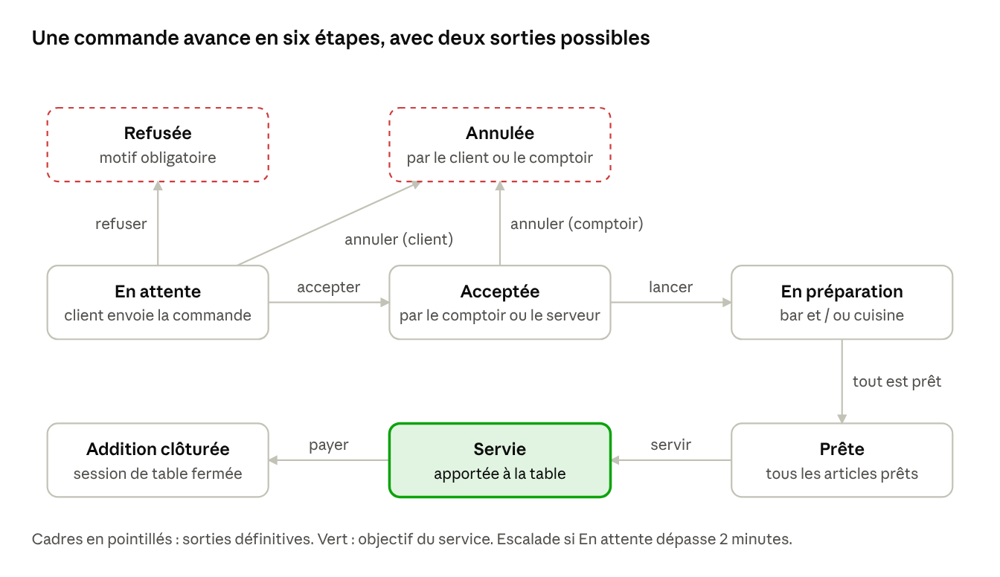
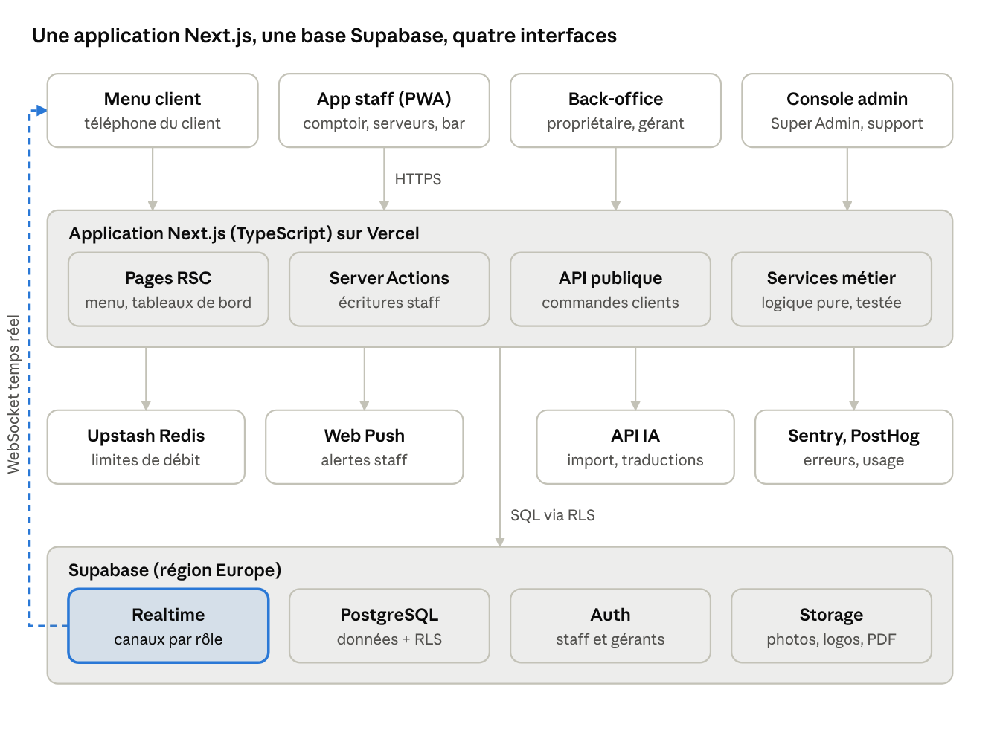
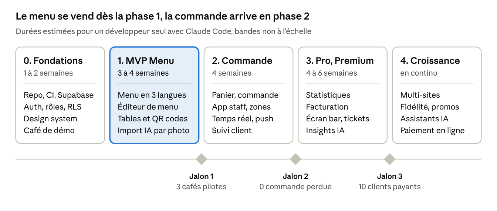

> **Historical document — original specification (2026-10-11).** It has been audited and amended. **Do not implement from this file.** Use `docs/spec/*` (domain specs with all decisions applied) and `docs/adr/*` (decisions, which win over everything). See ADR-0001.

# Cahier des Charges — Plateforme SaaS de Menu Digital & Commande par QR Code

Oct 11, 2026 · @Sbridge

## 1. Présentation du projet

Le projet est une plateforme SaaS multi-établissements qui remplace le menu papier par un menu digital accessible via QR code, avec en option la commande à table transmise en temps réel au comptoir et aux serveurs. Nom de travail : **Tawla** (« table » en tunisien), à valider.

### 1.1 Contexte

En Tunisie, la majorité des cafés et restaurants utilisent encore des menus papier. Ces menus s'abîment, ne se mettent pas à jour quand un prix change et obligent le serveur à faire des allers-retours pour chaque prise de commande.

### 1.2 Problématique

- **Pour le client** : attente avant de pouvoir commander, menu peu lisible, pas de photos, prix parfois absents.

- **Pour le serveur** : temps perdu à circuler entre les tables pour prendre les commandes, erreurs de transmission au comptoir.

- **Pour le gérant** : réimpression coûteuse à chaque changement de prix, aucune donnée sur les produits les plus vendus ou les heures de pointe.

### 1.3 Objectifs

1.  Permettre à chaque établissement d'afficher un menu digital moderne, mis à jour par le gérant lui-même en moins d'une minute.

2.  Permettre au client de commander depuis sa table sans application à installer et sans créer de compte.

3.  Transmettre chaque commande en moins de 2 secondes au comptoir et au serveur concerné, avec le numéro de table.

4.  Donner au gérant des statistiques exploitables : ventes, produits phares, heures de pointe.

5.  Construire un produit vendable par abonnement, configurable par offre, sans développement spécifique par client.

### 1.4 Cibles

| Cible | Description | Besoin principal |
|----|----|----|
| Cafés | Établissements à forte rotation, ticket moyen faible | Rapidité de service, mise à jour des prix |
| Restaurants | Carte plus large, options et suppléments | Photos, descriptions, gestion des options |
| Salons de thé et pâtisseries | Clientèle familiale et touristique | Menu visuel et multilingue |
| Fast-foods | Commande et préparation rapides | Transmission directe à la préparation |

### 1.5 Principes directeurs

- **Zéro friction client** : scan, menu affiché en moins de 2 secondes, aucune inscription.

- **Autonomie du gérant** : toute la configuration se fait depuis son tableau de bord.

- **Une seule base de code** : chaque établissement est un tenant, les fonctionnalités s'activent par offre.

- **Mobile-first et sobre en données** : la connexion Wi-Fi ou 4G des établissements est souvent faible.

## 2. Périmètre et offres

La plateforme est vendue en trois offres qui partagent le même code ; chaque fonctionnalité est activée ou non par un système de *feature flags* lié à l'abonnement de l'établissement.

### 2.1 Offres commerciales

| Fonctionnalité | Basic (menu) | Pro (commande) | Premium |
|----|----|----|----|
| Menu digital via QR code, catégories, produits, photos, prix | Oui | Oui | Oui |
| Personnalisation (logo, couleurs, couverture) | Oui | Oui | Oui |
| Menu multilingue (AR / FR / EN) | Oui | Oui | Oui |
| Bouton « Appeler le serveur » et « Demander l'addition » | Oui | Oui | Oui |
| Rupture de stock en un clic | Oui | Oui | Oui |
| Panier et envoi de commande depuis la table | Non | Oui | Oui |
| Notifications temps réel comptoir et serveurs | Non | Oui | Oui |
| Suivi du statut de commande par le client | Non | Oui | Oui |
| Comptes staff (serveurs, comptoir) | 1 compte | Jusqu'à 10 | Illimité |
| Zones de service (affectation des tables aux serveurs) | Non | Oui | Oui |
| Écran de préparation bar / cuisine | Non | Non | Oui |
| Statistiques | Basiques (vues du menu) | Ventes et produits | Avancées + insights IA |
| Fonctionnalités IA (import menu, traductions, descriptions) | Import menu seulement | Oui | Oui |
| Promotions, happy hour, prix par créneau | Non | Non | Oui |
| Impression ticket sur imprimante thermique | Non | Non | Oui |
| Multi-établissements (chaînes) | Non | Non | Oui |

### 2.2 Feature flags

Chaque fonctionnalité optionnelle a une clé unique (ex. ordering, staff_zones, kitchen_display, ai_insights). L'offre définit les flags par défaut, et le Super Admin peut forcer un flag pour un établissement (essai, geste commercial). Le contrôle est fait côté serveur, jamais seulement dans l'interface.

### 2.3 Hors périmètre (version 1)

- Livraison à domicile et commande à emporter en ligne.

- Application mobile native (iOS / Android) : le client et le staff utilisent une PWA.

- Gestion de stock détaillée (matières premières, fournisseurs).

- Caisse enregistreuse certifiée et comptabilité.

- Paiement en ligne du client (prévu en phase 4, voir section 17).

## 3. Acteurs, rôles et permissions

La plateforme compte sept rôles : deux côté plateforme, quatre côté établissement et le client anonyme. Un utilisateur staff peut avoir un rôle différent dans plusieurs établissements.

### 3.1 Description des rôles

| Rôle | Périmètre | Appareil type | Responsabilités |
|----|----|----|----|
| Super Admin | Toute la plateforme | Ordinateur | Crée les établissements, gère les abonnements, active les flags, consulte les métriques globales |
| Support | Toute la plateforme, lecture + actions limitées | Ordinateur | Aide les gérants, peut se connecter « en tant que » un établissement (tracé dans le journal d'audit) |
| Propriétaire (Owner) | Son ou ses établissements | Ordinateur, tablette, mobile | Tout gérer : menu, tables, staff, paramètres, abonnement, statistiques |
| Gérant (Manager) | Un établissement | Tablette, mobile | Menu, tables, staff, commandes, statistiques ; pas d'accès à l'abonnement |
| Comptoir / Caisse | Un établissement | Tablette fixe au comptoir | Voit toutes les commandes, accepte, change les statuts, clôture les additions |
| Serveur | Un établissement, ses zones | Mobile | Reçoit les commandes et appels de ses tables, accepte, marque « servie » |
| Préparation (Bar / Cuisine) | Un établissement, son poste | Tablette ou écran | Voit les articles à préparer, marque « prêt » |
| Client (visiteur) | Une table, une session | Son téléphone | Consulte le menu, remplit le panier, commande, appelle le serveur |

### 3.2 Matrice des permissions

| Action | Owner | Manager | Comptoir | Serveur | Préparation | Client |
|----|----|----|----|----|----|----|
| Consulter le menu public | Oui | Oui | Oui | Oui | Oui | Oui |
| Créer / modifier catégories et produits | Oui | Oui | Non | Non | Non | Non |
| Marquer un produit en rupture | Oui | Oui | Oui | Oui | Oui | Non |
| Gérer tables, zones et QR codes | Oui | Oui | Non | Non | Non | Non |
| Gérer les comptes staff | Oui | Oui | Non | Non | Non | Non |
| Passer une commande | Oui | Oui | Oui | Oui | Non | Oui |
| Accepter / refuser une commande | Oui | Oui | Oui | Oui (ses zones) | Non | Non |
| Changer le statut d'un article (préparation, prêt) | Oui | Oui | Oui | Non | Oui | Non |
| Marquer une commande servie | Oui | Oui | Oui | Oui | Non | Non |
| Annuler une commande acceptée | Oui | Oui | Oui | Non | Non | Non |
| Clôturer l'addition d'une table | Oui | Oui | Oui | Oui | Non | Non |
| Voir les statistiques | Oui | Oui | Non | Non | Non | Non |
| Modifier paramètres et branding | Oui | Oui | Non | Non | Non | Non |
| Gérer l'abonnement et la facturation | Oui | Non | Non | Non | Non | Non |

### 3.3 Règles d'application

- Les permissions sont vérifiées à trois niveaux : l'interface (masquer), le serveur (refuser) et la base de données (Row Level Security).

- Le rôle est porté par la relation utilisateur-établissement (memberships), pas par l'utilisateur.

- Toute action sensible (annulation, suppression, changement de prix, connexion « en tant que ») est écrite dans le journal d'audit.

## 4. Spécifications fonctionnelles — Client

Le client accède à tout depuis le navigateur de son téléphone après le scan, sans application ni compte. L'URL scannée identifie l'établissement et la table : https://tawla.tn/{slug-etablissement}/t/{token-table}.

### 4.1 Page d'accueil du menu

- En-tête avec image de couverture, logo, nom de l'établissement, statut ouvert / fermé selon les horaires.

- Badge « Table 9 » visible en permanence pour rassurer le client.

- Infos pratiques repliables : horaires, adresse avec lien Google Maps, mot de passe Wi-Fi, réseaux sociaux.

- Sélecteur de langue (AR / FR / EN) avec détection automatique de la langue du téléphone et support RTL complet pour l'arabe.

### 4.2 Navigation dans le menu

- Barre de catégories horizontale et collante (*sticky*), avec icône ou image par catégorie, synchronisée au défilement (*scroll-spy*).

- Recherche instantanée par nom de produit, tolérante aux fautes et aux accents.

- Filtres optionnels : végétarien, sans gluten, épicé, nouveauté.

- Carte produit : photo, nom, description courte, prix, badges (Nouveau, Populaire, Épicé, Indisponible).

- Produit en rupture affiché grisé avec la mention « Indisponible », jamais caché sans prévenir.

- Fiche produit en *bottom sheet* : grande photo, description complète, allergènes, options et suppléments, quantité, note libre (« sans sucre »).

### 4.3 Options et suppléments

Un produit peut avoir plusieurs groupes d'options. Chaque groupe précise s'il est obligatoire, le nombre minimum et maximum de choix, et le prix de chaque choix.

| Exemple de groupe | Type | Règle |
|----|----|----|
| Taille (Petit, Grand +1,500 DT) | Choix unique | Obligatoire |
| Sucre (Normal, Peu, Sans) | Choix unique | Obligatoire, gratuit |
| Suppléments (Fromage +2,000 DT, Œuf +1,000 DT) | Choix multiple | Optionnel, maximum 3 |

### 4.4 Panier (offre Pro et plus)

- Bouton panier flottant avec nombre d'articles et total, animé à chaque ajout.

- Panier en *bottom sheet* : modification des quantités, suppression, note générale pour la commande.

- Panier sauvegardé localement : il survit à un rafraîchissement ou à une coupure réseau.

- Suggestions « Souvent pris avec » avant validation (voir section 16).

- Bouton « Envoyer la commande » avec récapitulatif et confirmation explicite.

### 4.5 Suivi de commande

- Écran de suivi en temps réel : En attente, Acceptée, En préparation, Prête, Servie.

- Le client peut passer plusieurs commandes successives pendant sa session ; elles s'ajoutent à l'addition de la table.

- Annulation possible par le client tant que la commande est « En attente ».

- Message clair si la commande est refusée, avec le motif choisi par le staff.

### 4.6 Demandes de service (toutes offres)

- **Appeler le serveur** : envoie une alerte au serveur de la zone, avec un délai minimum de 60 secondes entre deux appels.

- **Demander l'addition** : choix du mode de paiement (espèces, carte) pour que le serveur arrive préparé.

- **Voir mon addition** : liste de tout ce qui a été commandé à la table pendant la session, avec le total.

### 4.7 Après le service

- Notation rapide de l'expérience (1 à 5 étoiles) et commentaire optionnel, visible seulement par le gérant.

- Si la note est de 4 ou 5, proposition de laisser un avis Google (lien configurable).

### 4.8 Formats et affichage des prix

Le dinar tunisien a trois décimales. Les prix sont stockés en millimes (entier, ex. 3500) et affichés au format local : 3,500 DT en français, 3.500 د.ت en arabe. Aucun calcul de prix ne se fait en nombre à virgule.

## 5. Spécifications fonctionnelles — Staff

L'espace staff est une PWA installée sur la tablette du comptoir et les téléphones des serveurs. Chaque commande y apparaît en moins de 2 secondes, avec son numéro de table, un signal sonore et une vibration.

### 5.1 Connexion staff

- Connexion par e-mail et mot de passe pour Owner et Manager.

- Connexion rapide par **code PIN à 4 chiffres** pour serveurs et comptoir, sur un appareil déjà associé à l'établissement.

- Session longue sur la tablette du comptoir (mode « poste fixe »), déconnexion automatique après 12 heures sur mobile.

- Indicateur de connexion temps réel (vert / orange / rouge) toujours visible.

### 5.2 Écran comptoir

Vue en colonnes (*kanban*) : **Nouvelles**, **Acceptées / En préparation**, **Prêtes**, **Servies (dernière heure)**.

- Chaque carte affiche : numéro de table en grand, heure, minuteur depuis la réception, articles avec options et notes, total.

- Code couleur du minuteur : normal jusqu'à 5 minutes, orange jusqu'à 10, rouge au-delà (seuils configurables).

- Actions en un geste : Accepter, Refuser (avec motif), Passer à l'étape suivante.

- Vue « Plan de salle » : grille des tables avec leur état (libre, occupée, commande en attente, addition demandée).

- Vue « Additions » : total par table, clôture de la session après paiement.

- Le comptoir peut créer une commande manuelle pour une table (client sans téléphone).

### 5.3 Application serveur

- Liste des commandes et demandes de **ses zones uniquement**, triées par urgence.

- Notification d'un appel serveur ou d'une demande d'addition avec le numéro de table et le mode de paiement souhaité.

- Bouton « Je m'en occupe » : la demande disparaît chez les autres serveurs pour éviter les doublons.

- Bouton « Servie » quand la commande est apportée à la table.

- Prise de commande pour le client depuis le téléphone du serveur (même interface que le menu client).

### 5.4 Zones de service

Le gérant découpe la salle en zones (ex. Terrasse, Salle, Étage) et affecte les tables à chaque zone. Les serveurs choisissent leurs zones au début du service.

### 5.5 Routage des notifications

Le gérant choisit le mode de routage dans les paramètres :

| Mode | Qui reçoit la commande | Usage conseillé |
|----|----|----|
| Comptoir seulement | La tablette du comptoir | Petits cafés, un seul poste de préparation |
| Serveurs seulement | Les serveurs de la zone de la table | Restaurants où le serveur gère tout |
| Comptoir + serveurs (défaut) | Les deux, en parallèle | La majorité des établissements |

Escalade automatique : une commande non acceptée après 2 minutes déclenche une seconde alerte sonore et une notification au gérant (délai configurable).

### 5.6 Écran de préparation (offre Premium)

- Chaque produit est rattaché à un poste : Bar, Cuisine, Pâtisserie.

- Une commande mixte est découpée : le bar ne voit que les boissons, la cuisine que les plats.

- Le poste marque chaque article « Prêt » ; la commande passe « Prête » quand tous ses articles le sont.

- Affichage grand format lisible à 2 mètres, compatible écran TV via navigateur.

### 5.7 Notifications

- Application ouverte : son distinct par type d'événement (nouvelle commande, appel serveur, addition) et vibration.

- Application en arrière-plan ou écran verrouillé : notification Web Push.

- Sur iPhone, le Web Push exige que la PWA soit ajoutée à l'écran d'accueil ; l'onboarding staff guide cette étape.

- Mode « écran toujours allumé » (Wake Lock API) sur la tablette du comptoir.

## 6. Back-office gérant

Le back-office permet au gérant de tout configurer seul, depuis un ordinateur ou une tablette. Objectif mesurable : un nouvel établissement publie son menu complet en moins de 30 minutes.

### 6.1 Onboarding guidé

1.  Informations de l'établissement : nom, type, adresse, téléphone, horaires.

2.  Identité visuelle : logo, couleur principale (proposée automatiquement à partir du logo), image de couverture.

3.  Import du menu : saisie manuelle, import Excel / CSV, ou **photo du menu papier analysée par l'IA** (section 16).

4.  Création des tables : nombre de tables, numérotation, zones.

5.  Génération et téléchargement des QR codes.

6.  Invitation du staff.

Une checklist de progression reste visible sur le tableau de bord tant que l'onboarding n'est pas terminé.

### 6.2 Gestion du menu

- **Catégories** : nom multilingue, icône ou image, ordre par glisser-déposer, visibilité, créneau horaire (ex. « Petit-déjeuner » de 7h à 11h).

- **Produits** : nom et description multilingues, prix, photo, catégorie, poste de préparation, badges, allergènes, ordre, visibilité.

- **Options** : groupes réutilisables (ex. « Sucre » partagé par toutes les boissons chaudes).

- **Disponibilité** : interrupteur « Disponible » accessible en un clic depuis la liste, et depuis l'app staff.

- **Actions groupées** : modifier les prix d'une catégorie en pourcentage, masquer plusieurs produits, dupliquer.

- **Aperçu en direct** : prévisualisation mobile du menu à côté de l'éditeur.

- **Historique des prix** : chaque changement est conservé ; une commande garde toujours le prix au moment de l'achat.

### 6.3 Tables et QR codes

- Création unitaire ou en lot (ex. tables 1 à 30), affectation aux zones.

- QR code unique par table, contenant un jeton aléatoire (jamais le numéro seul).

- Bouton « Régénérer le QR » : l'ancien jeton cesse de fonctionner immédiatement.

- Export PDF prêt à imprimer : un modèle de chevalet par table avec logo, numéro, QR code et consigne « Scannez pour commander » en trois langues.

- QR général sans table (vitrine, réseaux sociaux) : menu en lecture seule.

### 6.4 Staff

- Invitation par e-mail ou création directe avec code PIN.

- Attribution du rôle, désactivation immédiate d'un compte.

- Vue des sessions actives et déconnexion à distance d'un appareil.

### 6.5 Paramètres

- Commandes : activées ou non, validation par le staff obligatoire ou non, mode de routage, seuils d'escalade.

- Langues activées et langue par défaut.

- Horaires d'ouverture : commande bloquée en dehors des horaires, menu toujours consultable.

- Thème du menu client : couleur principale, mode clair / sombre / automatique, style de cartes (liste ou grille).

- Liens : Google Avis, Instagram, Facebook, TikTok, Wi-Fi.

### 6.6 Tableau de bord et statistiques

| Indicateur | Offre | Détail |
|----|----|----|
| Scans et vues du menu | Toutes | Par jour, par table, par langue |
| Chiffre d'affaires des commandes | Pro, Premium | Jour, semaine, mois, comparaison à la période précédente |
| Nombre de commandes et ticket moyen | Pro, Premium | Par jour et par heure |
| Top et flop produits | Pro, Premium | Quantités et chiffre d'affaires |
| Heures de pointe | Pro, Premium | Carte de chaleur jour × heure |
| Temps de service | Pro, Premium | Délai moyen réception → acceptation → servie |
| Performance par serveur | Premium | Commandes traitées, délai moyen |
| Satisfaction | Toutes | Note moyenne et commentaires |
| Insights IA | Premium | Analyses rédigées en langage naturel (section 16) |

Export CSV et PDF de toutes les statistiques.

## 7. Console Super Admin

La console Super Admin est réservée à l'éditeur de la plateforme ; elle sert à vendre, activer, suivre et dépanner les établissements clients.

### 7.1 Gestion des établissements

- Liste avec recherche et filtres : offre, statut (essai, actif, impayé, suspendu), ville, date d'inscription.

- Fiche établissement : informations, abonnement, flags actifs, utilisateurs, volume d'activité, historique des paiements.

- Création d'un établissement pour le compte d'un client (vente terrain) avec envoi de l'invitation au propriétaire.

- Suspension et réactivation : un établissement suspendu affiche un menu en lecture seule pendant 7 jours, puis une page neutre.

- Connexion « en tant que » un établissement pour le support, avec bannière visible et trace dans l'audit.

### 7.2 Abonnements et facturation

- Catalogue des offres : prix mensuel et annuel, flags inclus, limites (nombre de tables, de staff, de produits).

- Période d'essai de 14 jours sur l'offre Pro, sans carte bancaire.

- Enregistrement des paiements manuels (espèces, virement, D17) au lancement, puis paiement en ligne via une passerelle tunisienne (Konnect ou Flouci, à évaluer).

- Génération automatique des factures PDF numérotées, avec les mentions légales tunisiennes (matricule fiscal, TVA).

- Relances automatiques avant échéance (J-7, J-1) et après impayé (J+3, J+7).

### 7.3 Pilotage de la plateforme

- Indicateurs : revenu mensuel récurrent (MRR), nombre d'établissements actifs, taux de conversion essai → payant, taux de résiliation, commandes par jour.

- Journal d'audit global consultable et filtrable.

- Gestion des annonces : message affiché dans le back-office de tous les gérants (nouveauté, maintenance).

- Gestion des modèles : chevalets QR, thèmes de menu, catégories types par métier (café, pizzeria, pâtisserie).

## 8. Cycle de vie d'une commande et parcours utilisateurs

Une commande passe par six statuts dans un ordre fixe, et chaque passage est déclenché par une action identifiée (client ou staff) puis enregistré dans order_events.

cycle de vie d'une commande · 6 étapes, 2 sorties

Le client ne peut annuler que tant que la commande est En attente ; au-delà, seul le comptoir ou le gérant peut annuler, avec motif.

### 8.1 Règles de transition

| Transition | Qui | Condition | Effets |
|----|----|----|----|
| → En attente | Client ou staff | Session de table valide, établissement ouvert, produits disponibles | Alerte comptoir et serveurs de la zone, minuteur lancé |
| En attente → Acceptée | Comptoir, serveur, manager | — | Client notifié, alerte retirée chez les autres membres |
| En attente → Refusée | Comptoir, serveur, manager | Motif choisi (rupture, table inconnue, fermé, autre) | Client notifié avec le motif |
| En attente → Annulée | Client | Avant acceptation | Alerte retirée chez le staff |
| Acceptée → En préparation | Comptoir ou poste | — | Articles envoyés aux postes bar / cuisine |
| Acceptée ou En préparation → Annulée | Comptoir, manager | Motif obligatoire | Audit, client notifié |
| En préparation → Prête | Poste ou comptoir | Tous les articles prêts | Alerte au serveur de la zone |
| Prête → Servie | Serveur ou comptoir | — | Ajout à l'addition de la table |
| Servie → clôturée | Comptoir ou serveur | Paiement encaissé | Session fermée, demande d'avis envoyée au client |

Dans l'offre sans écran de préparation, le comptoir peut passer directement d'Acceptée à Prête. Les demandes de service suivent un cycle court : Ouverte → Prise en charge → Traitée.

### 8.2 Parcours client — offre Basic (menu seul)

1.  Le client s'assoit à la table 9 et scanne le QR code.

2.  Le menu s'ouvre dans sa langue, avec le badge « Table 9 ».

3.  Il consulte les catégories, les photos et les prix.

4.  Il appuie sur « Appeler le serveur » ; le serveur reçoit « Table 9 ».

5.  Le serveur prend la commande oralement, comme aujourd'hui, mais sans faire attendre le client pour le menu.

### 8.3 Parcours client — offre Pro (commande)

1.  Scan du QR, ouverture de la session de table 9.

2.  Ajout de produits au panier, avec options et notes.

3.  Envoi de la commande, écran de suivi affiché.

4.  Le comptoir et le serveur de la zone reçoivent l'alerte « Table 9 — Commande \#047 ».

5.  Le serveur accepte ; le client voit « Acceptée » en direct.

6.  Le comptoir prépare, marque « Prête » ; le serveur la porte à la table 9 et marque « Servie ».

7.  Le client peut recommander ; tout s'ajoute à l'addition de la table.

8.  Il demande l'addition en choisissant le mode de paiement ; le serveur arrive avec le montant exact.

9.  Après paiement, la session est clôturée et le client est invité à noter sa visite.

### 8.4 Parcours gérant — premier jour

1.  Inscription et création de l'établissement.

2.  Photo du menu papier, import par l'IA, correction des prix.

3.  Ajout du logo ; la couleur du thème est proposée automatiquement.

4.  Création de 20 tables en 2 zones.

5.  Téléchargement du PDF des chevalets QR et impression.

6.  Ajout de 3 serveurs avec code PIN, installation de la PWA sur leurs téléphones.

7.  Commande test depuis une table, vérification de la réception.

## 9. Architecture technique et stack

La stack retenue est **Next.js + TypeScript + Supabase** : une seule application sert les quatre interfaces, et Supabase fournit base de données, authentification, temps réel et stockage. C'est le meilleur rapport vitesse / robustesse pour un développeur seul assisté par Claude Code.

architecture · 4 interfaces, 1 application, 1 base

Le temps réel (en pointillés) part directement de Supabase vers les navigateurs : les commandes arrivent au staff sans passer par un serveur supplémentaire.

### 9.1 Stack détaillée

| Couche | Technologie | Justification |
|----|----|----|
| Langage | TypeScript (strict) | Un seul langage front et back, erreurs détectées avant l'exécution |
| Framework | Next.js, dernière version stable (App Router, React Server Components, Server Actions) | Rendu serveur rapide pour le menu, API intégrée, excellent support par Claude Code |
| UI | React, Tailwind CSS, shadcn/ui, Motion, Lucide | Design moderne, composants accessibles, code dans le projet |
| Formulaires et validation | React Hook Form + Zod | Schémas partagés client / serveur |
| État client | TanStack Query (données serveur), Zustand (panier) | Cache, synchronisation, panier persistant |
| Base de données | PostgreSQL (Supabase) | Relationnel, RLS natif pour le multi-tenant |
| ORM et migrations | Drizzle ORM + migrations SQL Supabase | Typage de bout en bout, SQL lisible |
| Authentification | Supabase Auth | E-mail, lien magique, OAuth, sessions sécurisées |
| Temps réel | Supabase Realtime (Broadcast et Postgres Changes) | WebSockets gérés, autorisations par canal |
| Stockage | Supabase Storage + transformation d'images | Photos produits redimensionnées à la volée |
| i18n | next-intl | FR / AR / EN, RTL |
| PWA et push | Serwist (service worker) + Web Push (VAPID) | Installation, cache, notifications |
| Limites de débit | Upstash Redis | Anti-spam serverless |
| E-mails | Resend + React Email | Invitations, factures, relances |
| QR et PDF | qrcode + @react-pdf/renderer | Chevalets imprimables |
| IA | API d'un modèle multimodal via un module features/ai isolé | Fournisseur interchangeable |
| Hébergement | Vercel (application), Supabase (région Europe, la plus proche de la Tunisie) | Déploiement automatique, CDN mondial |
| Outillage | pnpm, ESLint, Prettier, Husky, Vitest, Playwright, GitHub Actions | Qualité automatisée |

### 9.2 Multi-tenant

- Une base partagée, isolation par restaurant_id + Row Level Security.

- Le middleware Next.js résout l'établissement à partir du slug dans l'URL (et plus tard d'un sous-domaine cafe.tawla.tn ou d'un domaine personnalisé pour l'offre Premium).

- Le contexte (établissement, rôle, flags) est chargé une fois par requête et passé explicitement aux services.

### 9.3 Décisions d'architecture

- **Monolithe modulaire** plutôt que microservices : plus simple à développer, tester et déployer seul ; les modules features/ permettent d'extraire un service plus tard si nécessaire.

- **Supabase plutôt qu'un backend NestJS + Socket.io** : moins d'infrastructure à maintenir ; un serveur temps réel dédié reste possible si le volume l'exige.

- **PWA plutôt qu'applications natives** : un seul code, aucune validation App Store, mises à jour instantanées.

- Chaque décision importante est consignée dans docs/adr/ (Architecture Decision Records).

## 10. Modèle de données

Toutes les tables métier portent une colonne restaurant_id et sont protégées par Row Level Security : un établissement ne peut jamais lire les données d'un autre, même en cas de bug applicatif.

### 10.1 Conventions

- Clés primaires en UUID v7 (triables dans le temps), noms de tables en snake_case au pluriel.

- Colonnes created_at, updated_at sur toutes les tables ; deleted_at (suppression logique) sur les données métier.

- Montants en millimes (integer), jamais en float.

- Textes multilingues en jsonb : {"fr": "Café crème", "ar": "قهوة بالحليب", "en": "Coffee with milk"}.

- Statuts en enum PostgreSQL, transitions contrôlées côté serveur.

### 10.2 Entités

| Table | Champs principaux | Rôle |
|----|----|----|
| restaurants | slug, name, type, logo_url, cover_url, theme (jsonb), timezone, currency, default_locale, locales\[\], opening_hours (jsonb), settings (jsonb), status | Le tenant |
| plans | code, name, price_monthly, price_yearly, limits (jsonb), features\[\] | Catalogue des offres |
| subscriptions | restaurant_id, plan_id, status, trial_ends_at, current_period_end | Abonnement en cours |
| feature_overrides | restaurant_id, feature_key, enabled, expires_at | Forçage d'un flag par le Super Admin |
| payments / invoices | restaurant_id, amount, method, reference, paid_at, pdf_url | Facturation de la plateforme |
| users | email, full_name, phone, locale, platform_role | Comptes (gérés par Supabase Auth) |
| memberships | user_id, restaurant_id, role, pin_hash, is_active | Rôle d'un utilisateur dans un établissement |
| zones | restaurant_id, name, sort_order | Zones de service |
| staff_zone_assignments | membership_id, zone_id, shift_date | Zones d'un serveur pour le service |
| tables | restaurant_id, zone_id, number, label, qr_token, qr_token_rotated_at, is_active | Tables physiques |
| categories | restaurant_id, name (jsonb), image_url, sort_order, is_visible, available_from, available_to | Catégories du menu |
| products | restaurant_id, category_id, name, description (jsonb), price, image_url, station, badges\[\], allergens\[\], is_available, is_visible, sort_order | Produits |
| option_groups | restaurant_id, name (jsonb), min_select, max_select, is_required | Groupes d'options réutilisables |
| options | option_group_id, name (jsonb), price_delta, is_available, sort_order | Choix d'un groupe |
| product_option_groups | product_id, option_group_id, sort_order | Liaison produits ↔ groupes |
| price_history | product_id, old_price, new_price, changed_by | Historique des prix |
| table_sessions | restaurant_id, table_id, status (open, bill_requested, closed), opened_at, closed_at, payment_method | Une occupation de table, regroupe les commandes et l'addition |
| orders | restaurant_id, table_session_id, table_id, number, status, source (client, staff), note, subtotal, total, client_device_id, accepted_by, timestamps par statut | Commande |
| order_items | order_id, product_id, product_snapshot (jsonb), quantity, unit_price, options_snapshot (jsonb), note, station, status | Lignes de commande, figées au moment de l'achat |
| order_events | order_id, from_status, to_status, actor_id, reason, created_at | Historique des transitions |
| service_requests | restaurant_id, table_session_id, type (call_waiter, bill), payment_method, status, handled_by | Appels serveur et additions |
| feedbacks | restaurant_id, table_session_id, rating, comment | Notes clients |
| menu_views | restaurant_id, table_id, locale, device_id, viewed_at | Statistiques de scans (agrégées chaque nuit) |
| push_subscriptions | membership_id, endpoint, keys (jsonb), device_label | Abonnements Web Push du staff |
| audit_logs | restaurant_id, actor_id, action, entity, entity_id, diff (jsonb), ip | Journal d'audit |

### 10.3 Règles d'intégrité

- order_items copie le nom, le prix et les options au moment de la commande : modifier ou supprimer un produit ne change jamais une commande passée.

- Le total d'une commande est toujours recalculé par le serveur à partir des prix en base, jamais repris du navigateur.

- Le numéro de commande (number) est séquentiel par établissement et par jour (ex. \#047), plus lisible qu'un UUID pour le staff.

- Index sur (restaurant_id, status, created_at) pour orders et sur (restaurant_id, qr_token) pour tables.

## 11. API, temps réel et notifications

Les écritures passent par des Server Actions et des Route Handlers Next.js validés par Zod ; la diffusion temps réel passe par Supabase Realtime, et les alertes hors application par Web Push.

### 11.1 Principes d'API

- Chaque entrée est validée par un schéma Zod partagé entre client et serveur.

- La logique métier vit dans une couche services indépendante de Next.js, testable seule.

- Les réponses d'erreur suivent un format unique : { code, message, details? }, avec des codes stables (TABLE_TOKEN_INVALID, PRODUCT_UNAVAILABLE, ORDERING_DISABLED, RATE_LIMITED).

- Les opérations de commande sont idempotentes : le client envoie une clé idempotency_key, un double clic ne crée jamais deux commandes.

### 11.2 Endpoints publics (client)

| Méthode | Route | Description |
|----|----|----|
| GET | /api/public/{slug}/menu?locale=fr | Menu complet, mis en cache et revalidé à chaque modification |
| GET | /api/public/table/{token} | Vérifie le jeton et ouvre ou reprend la session de table |
| POST | /api/public/orders | Crée une commande (session, articles, options, notes, clé d'idempotence) |
| GET | /api/public/orders/{id} | Statut d'une commande de la session |
| POST | /api/public/orders/{id}/cancel | Annulation tant que la commande est en attente |
| POST | /api/public/service-requests | Appel serveur ou demande d'addition |
| GET | /api/public/sessions/{id}/bill | Addition de la table |
| POST | /api/public/feedbacks | Note et commentaire |

### 11.3 Actions staff et gérant

Les actions authentifiées sont des Server Actions : acceptOrder, rejectOrder, advanceOrderStatus, markItemReady, toggleProductAvailability, claimServiceRequest, closeTableSession, ainsi que le CRUD du menu, des tables, des zones et du staff. Chacune vérifie la session, le rôle, le flag d'offre puis écrit un order_event ou un audit_log.

### 11.4 Canaux temps réel

| Canal | Abonnés | Événements |
|----|----|----|
| restaurant:{id}:orders | Comptoir, Manager | order.created, order.updated, order.cancelled |
| restaurant:{id}:zone:{zoneId} | Serveurs de la zone | order.created, order.ready, service_request.created |
| restaurant:{id}:station:{station} | Écran bar ou cuisine | items.to_prepare, item.updated |
| session:{sessionId} | Client de la table | order.status_changed, service_request.handled |
| restaurant:{id}:menu | Clients connectés, staff | product.availability_changed |

Les canaux staff sont protégés par l'authentification Supabase et des politiques d'autorisation Realtime. Le canal client est lié à un jeton de session signé et limité à sa propre table.

### 11.5 Fiabilité du temps réel

- À la reconnexion, l'interface recharge l'état complet par une requête HTTP avant de reprendre l'écoute : aucun événement manqué ne fait disparaître une commande.

- Si le WebSocket est indisponible, bascule automatique sur un rafraîchissement toutes les 10 secondes.

- Chaque événement porte un version : une mise à jour plus ancienne que l'état affiché est ignorée.

### 11.6 Web Push

- Clés VAPID, abonnements stockés dans push_subscriptions.

- Envoi déclenché par le serveur après création d'une commande ou d'une demande de service, vers les membres concernés par le routage (section 5.5).

- Abonnements expirés supprimés automatiquement à la première erreur 404 ou 410.

## 12. Sécurité, anti-abus et conformité

Le risque principal est la commande frauduleuse : quelqu'un qui commande depuis l'extérieur ou pour une autre table. La défense combine jetons aléatoires, sessions signées, limites de débit et validation humaine.

### 12.1 QR codes et sessions de table

- Le QR contient un jeton aléatoire de 128 bits minimum, jamais le numéro de table ni un identifiant devinable.

- Au scan, le serveur crée un cookie de session signé (HttpOnly, Secure, SameSite=Lax) lié à la table et à l'appareil.

- La session client expire après 3 heures d'inactivité ou à la clôture de l'addition ; une commande exige une session valide.

- Le gérant peut régénérer un QR à tout moment (QR photographié et partagé, par exemple).

### 12.2 Anti-abus

| Menace | Contre-mesure |
|----|----|
| Commande depuis l'extérieur | Session de table limitée dans le temps, validation staff activable, horaires d'ouverture |
| Spam de commandes | Limite de 1 commande par 30 secondes et 10 par heure par session, plafond d'articles par commande |
| Spam d'appels serveur | 1 appel par 60 secondes par table |
| Prix modifié dans le navigateur | Total recalculé côté serveur à partir de la base |
| Robots | Limites de débit par IP (Upstash Redis), en-têtes de sécurité, Cloudflare Turnstile invisible en cas d'anomalie |
| Commande fantôme acceptée | Le staff voit l'historique de l'appareil ; possibilité de bloquer un appareil pour 24 heures |

### 12.3 Authentification et données staff

- Supabase Auth : e-mail + mot de passe, lien magique, connexion Google optionnelle pour les propriétaires.

- Mot de passe de 10 caractères minimum, vérification contre les fuites connues.

- Double authentification (TOTP) obligatoire pour le Super Admin, proposée aux propriétaires.

- Code PIN staff haché (Argon2 ou bcrypt), blocage temporaire après 5 essais.

### 12.4 Sécurité applicative

- Row Level Security activée sur 100 % des tables, testée par des tests automatisés (un utilisateur de l'établissement A ne voit rien de B).

- Clé service_role Supabase utilisée uniquement côté serveur, jamais exposée au navigateur.

- En-têtes : Content-Security-Policy, HSTS, X-Frame-Options, Referrer-Policy, Permissions-Policy.

- Téléversement d'images : types autorisés (JPEG, PNG, WebP), taille maximale 5 Mo, recompression côté serveur, métadonnées EXIF supprimées.

- Dépendances surveillées (Dependabot, pnpm audit) ; secrets uniquement dans les variables d'environnement.

- Respect des recommandations OWASP Top 10 et OWASP ASVS niveau 1.

### 12.5 Données personnelles et conformité

- Le client n'est jamais obligé de donner son nom, son téléphone ou son e-mail.

- Les données staff et propriétaires sont traitées conformément à la loi organique tunisienne n° 2004-63 sur la protection des données à caractère personnel ; déclaration auprès de l'INPDP à vérifier avec un juriste.

- Pages publiques : mentions légales, conditions générales d'utilisation et de vente, politique de confidentialité.

- Sauvegarde quotidienne de la base, conservée 30 jours, avec un test de restauration chaque mois.

- Export des données d'un établissement à sa demande, suppression définitive 90 jours après résiliation.

## 13. Design system, UX/UI et identité visuelle

Le design vise un rendu de niveau application native : sobre, rapide, animé avec retenue, et personnalisable aux couleurs de chaque établissement sans jamais casser la lisibilité.

### 13.1 Direction artistique

- **Menu client** : « appetite-first ». Les photos des produits portent l'émotion, l'interface s'efface. Grandes images, coins arrondis généreux, typographie nette, beaucoup d'espace.

- **Espace staff** : « glanceable ». Lisible à un mètre, numéros de table en très grand, couleurs d'état franches, cibles tactiles de 48 px minimum, zéro décoration.

- **Back-office** : « calm productivity ». Mise en page en grille *bento* pour le tableau de bord, éditeur avec aperçu en direct, palette de commandes Cmd/Ctrl + K.

- **Landing page commerciale** : moderne et premium, démonstration interactive d'un vrai menu à scanner depuis l'écran.

### 13.2 Tendances retenues (2026)

- Micro-interactions significatives : ajout au panier avec animation du produit vers le bouton panier, retour haptique (Vibration API) sur mobile.

- Transitions fluides entre pages (View Transitions API) et *bottom sheets* déplaçables au doigt.

- Chargement perçu instantané : squelettes (*skeletons*) aux dimensions finales, images floues préchargées (*blur placeholder*).

- Thème clair, sombre et automatique ; thème de marque dérivé de la couleur de l'établissement.

- Interfaces IA intégrées avec discrétion : suggestions à accepter en un clic, jamais imposées.

- À éviter : surcharge de verre dépoli (*glassmorphism*), dégradés criards, animations longues qui ralentissent la commande.

### 13.3 Design tokens

| Token | Valeur | Usage |
|----|----|----|
| Grille d'espacement | Multiples de 4 px (4, 8, 12, 16, 24, 32, 48, 64) | Marges, paddings, écarts |
| Rayons | 8 px (boutons), 16 px (cartes), 24 px (*sheets*) | Coins arrondis |
| Couleur de marque | --brand calculée depuis le logo, variantes 50 à 950 générées en OKLCH | Boutons principaux, accents |
| Couleurs sémantiques | succès, alerte, danger, info | États des commandes, messages |
| Typographie latine | Inter ou Geist | Toute l'interface |
| Typographie arabe | IBM Plex Sans Arabic ou Cairo | Menu et interface en arabe |
| Échelle de texte | 12 / 14 / 16 / 18 / 24 / 32 / 40 px | Hiérarchie |
| Ombres | 3 niveaux, très douces | Cartes, *sheets*, menus |
| Animations | 150 ms (micro), 250 ms (transitions), courbe *ease-out* | Toute animation |

Le contraste texte / fond reste conforme WCAG AA quelle que soit la couleur choisie par le gérant : si la couleur de marque est trop claire, le système assombrit automatiquement la variante utilisée pour le texte.

### 13.4 Composants clés

| Composant | Surface | Comportement attendu |
|----|----|----|
| Barre de catégories collante | Client | Défilement horizontal, catégorie active suivie au scroll |
| Carte produit | Client | Variantes liste et grille, état indisponible, badge |
| Fiche produit (*bottom sheet*) | Client | Glisser pour fermer, options validées en direct, prix mis à jour |
| Bouton panier flottant | Client | Compteur animé, total, masqué si panier vide |
| Suivi de commande | Client | Barre de progression par étape, horodatage |
| Carte commande | Staff | Numéro de table XXL, minuteur coloré, actions par balayage ou bouton |
| Plan de salle | Staff | Grille de tables avec état en couleur et icône |
| Éditeur de menu | Back-office | Glisser-déposer, édition en ligne, aperçu mobile en direct |
| Tuiles statistiques | Back-office | Valeur, variation, mini-graphique |

### 13.5 Outils et bibliothèques

- Composants : shadcn/ui (basé sur Radix), personnalisés dans le design system du projet.

- Styles : Tailwind CSS avec tokens en variables CSS.

- Animations : Motion (ex-Framer Motion), en respectant prefers-reduced-motion.

- Icônes : Lucide ; illustrations vides et d'onboarding cohérentes avec la marque.

- Graphiques : Recharts ou Tremor dans le back-office.

- Maquettes : Figma (ou un outil de design assisté par IA) avant tout nouvel écran ; le développement suit les maquettes validées.

### 13.6 Principes UX

- Trois gestes maximum entre le scan et l'ajout du premier produit au panier.

- Aucune boîte de dialogue bloquante sur le menu client ; les erreurs s'affichent en ligne, avec la solution.

- Chaque action destructive du back-office est annulable pendant 5 secondes (*toast* « Annuler ») plutôt que confirmée par une fenêtre.

- États vides utiles : chaque liste vide propose l'action suivante (« Ajoutez votre première catégorie »).

- Textes d'interface courts, au ton chaleureux, relus dans les trois langues par un locuteur natif.

## 14. Performance, accessibilité, internationalisation, SEO

Le menu client doit s'afficher en moins de 2 secondes sur un téléphone d'entrée de gamme en 4G moyenne, car c'est la première impression du produit.

### 14.1 Objectifs de performance

| Indicateur | Cible | Page |
|----|----|----|
| Largest Contentful Paint (LCP) | \< 2,0 s en 4G | Menu client |
| Interaction to Next Paint (INP) | \< 200 ms | Toutes |
| Cumulative Layout Shift (CLS) | \< 0,05 | Toutes |
| JavaScript initial | \< 150 Ko compressé | Menu client |
| Poids d'une image produit | \< 80 Ko (WebP ou AVIF) | Menu client |
| Score Lighthouse mobile | ≥ 90 dans chaque catégorie | Menu client, landing |
| Délai commande → notification staff | \< 2 s (p95) | Temps réel |

### 14.2 Moyens

- Menu rendu côté serveur (React Server Components), mis en cache et revalidé à la demande dès que le gérant modifie le menu.

- Images redimensionnées en plusieurs tailles, servies par CDN, chargement différé sous la ligne de flottaison.

- Polices auto-hébergées, sous-ensembles latin et arabe, font-display: swap.

- Service worker (PWA) : menu et assets mis en cache pour un rechargement instantané et une consultation hors ligne.

- Interface staff : les actions s'affichent immédiatement (*optimistic UI*) puis se synchronisent ; une action échouée est signalée et annulée visuellement.

### 14.3 Accessibilité

- Conformité WCAG 2.2 niveau AA sur le menu client et le back-office.

- Navigation complète au clavier, focus visible, libellés ARIA sur les boutons icônes.

- Texte alternatif sur les photos produits (généré par défaut à partir du nom).

- Zoom jusqu'à 200 % sans perte de contenu, tailles de texte en rem.

- Aucune information portée par la couleur seule : chaque statut a aussi une icône et un libellé.

### 14.4 Internationalisation

- Interface en français, arabe et anglais via next-intl ; fichiers de traduction par langue et par espace (client, staff, admin).

- Arabe en RTL complet : propriétés CSS logiques (ms-, me-, start, end), icônes directionnelles inversées.

- Contenu du menu traduit par le gérant ou par l'IA (section 16), avec retour à la langue par défaut si une traduction manque.

- Dates, heures et montants formatés avec Intl selon la langue et le fuseau Africa/Tunis.

### 14.5 SEO et partage

- Pages publiques des menus indexables (option désactivable), avec données structurées Schema.org Restaurant et Menu.

- Balises Open Graph : partage du menu sur WhatsApp et Instagram avec logo et couverture.

- Landing page optimisée pour les recherches locales (« menu QR code Tunisie », « menu digital café »).

## 15. Qualité : normes de code, tests, CI/CD, monitoring

Aucun code n'arrive en production sans passer le typage strict, le lint, les tests et une revue ; c'est ce qui permet de développer vite avec Claude Code sans accumuler de dette.

### 15.1 Normes de code

- TypeScript en mode strict, aucun any sans commentaire justificatif.

- ESLint et Prettier configurés une fois, exécutés automatiquement avant chaque commit (Husky + lint-staged).

- Architecture par fonctionnalité (*feature-based*) : chaque domaine (menu, commandes, tables, staff, facturation) regroupe ses composants, actions, schémas et tests.

- Logique métier pure dans services/, sans dépendance à React ni à Next.js.

- Nommage : composants en PascalCase, fonctions et variables en camelCase, fichiers en kebab-case, base de données en snake_case.

- Commits au format Conventional Commits (feat:, fix:, refactor:, test:, docs:).

- Branches : main (production), develop (pré-production), feat/... et fix/... fusionnées par Pull Request.

### 15.2 Stratégie de tests

| Niveau | Outil | Ce qui est testé | Cible |
|----|----|----|----|
| Unitaire | Vitest | Calcul des prix et options, machine à états des commandes, permissions, formatage des montants | 90 % de couverture sur services/ |
| Composants | Vitest + Testing Library | Carte produit, panier, fiche produit, carte commande | Composants critiques |
| Base de données | Tests SQL (pgTAP ou scripts Vitest) | Politiques RLS : isolation entre établissements et entre rôles | 100 % des tables |
| Bout en bout | Playwright | Scan → panier → commande → réception comptoir → servie ; onboarding gérant | Parcours critiques, mobile et tablette |
| Accessibilité | axe-core dans Playwright | Pages client et back-office | Zéro violation sérieuse |
| Charge | k6 | 200 commandes simultanées, 2 000 menus consultés par minute | p95 \< 500 ms |

### 15.3 Intégration et déploiement continus

1.  Chaque Pull Request déclenche GitHub Actions : installation, typage, lint, tests unitaires, build.

2.  Un environnement de prévisualisation est créé automatiquement (Vercel Preview) avec sa base de test.

3.  Les tests Playwright tournent sur cet environnement.

4.  Fusion sur develop → déploiement en pré-production ; fusion sur main → production.

5.  Les migrations de base de données sont versionnées et appliquées automatiquement, jamais à la main en production.

### 15.4 Environnements

| Environnement | Usage | Base de données |
|----|----|----|
| Local | Développement avec Claude Code | Supabase local (Docker) avec données de démonstration |
| Preview | Chaque Pull Request | Projet Supabase de test |
| Staging | Recette avant mise en production | Projet Supabase dédié |
| Production | Clients réels | Projet Supabase de production, sauvegardes activées |

### 15.5 Monitoring et exploitation

- Erreurs et performances : Sentry (front et back), avec alerte e-mail ou Telegram sur toute nouvelle erreur.

- Analytique produit : PostHog (entonnoir scan → ajout panier → commande, adoption des fonctionnalités).

- Disponibilité : sonde externe toutes les minutes sur le menu et l'API, page de statut publique.

- Journaux structurés (JSON) avec identifiant de requête et d'établissement.

- Objectif de disponibilité : 99,9 % pendant les heures d'ouverture des établissements.

## 16. Fonctionnalités à valeur ajoutée et IA

L'IA sert à deux choses : réduire l'effort du gérant (mise en place du menu en minutes) et augmenter son chiffre d'affaires (suggestions, analyses). Chaque résultat IA est une proposition que le gérant valide.

### 16.1 Fonctionnalités IA

| Fonctionnalité | Valeur | Fonctionnement | Phase |
|----|----|----|----|
| Import du menu par photo | Onboarding en 10 minutes au lieu de 2 heures ; argument de vente majeur | Le gérant photographie son menu papier ; un modèle multimodal extrait catégories, produits et prix ; le gérant corrige dans un tableau avant import | 1 |
| Traduction automatique AR / FR / EN | Menu touristique sans effort | Traduction de tous les noms et descriptions en un clic, glossaire métier (ex. « direct », « capucin », « citronnade » conservés) | 1 |
| Rédaction des descriptions | Menu plus appétissant | Description courte générée à partir du nom et des ingrédients, ton choisi par le gérant | 2 |
| Amélioration des photos | Rendu professionnel avec un téléphone | Détourage, fond uniforme, recadrage et correction de lumière | 3 |
| Suggestions « Souvent pris avec » | Hausse du ticket moyen | Règles d'association calculées sur l'historique des commandes de l'établissement ; règles manuelles possibles dès le départ | 2 |
| Insights en langage naturel | Le gérant comprend ses chiffres sans les analyser | Résumé hebdomadaire généré à partir des statistiques (ex. ventes en baisse le mardi, produit peu commandé à retirer) | 3 |
| Assistant gérant | Questions en français, arabe ou derja | « Combien de cafés vendus hier ? », « Augmente les jus de 10 % » : l'assistant répond ou propose l'action, le gérant confirme | 4 |
| Assistant client | Aide au choix pour les touristes et les indécis | « Quelque chose de frais sans sucre ? » ; réponses limitées aux produits du menu | 4 |

Règles d'intégration : appels IA uniquement côté serveur, sorties validées par un schéma Zod, quotas par établissement et par offre, journalisation des coûts, et aucune donnée personnelle de client envoyée au modèle.

### 16.2 Fonctionnalités métier à forte valeur

- **Happy hour et prix par créneau** : prix ou remise automatique selon l'heure et le jour.

- **Promotions et menus combinés** : formule « café + croissant » à prix fixe, produit du jour mis en avant en haut du menu.

- **Impression des tickets** sur imprimante thermique (ESC/POS) au bar et en cuisine, via un petit pont local ou un service d'impression cloud.

- **Programme de fidélité sans application** : numéro de téléphone facultatif, une boisson offerte toutes les 10 commandes.

- **Mode « événement »** : menu spécial Ramadan (horaires de rupture du jeûne, offres ftour et shour), matchs de football, soirées.

- **Multi-établissements** : un propriétaire gère plusieurs cafés depuis un seul compte, avec menu partagé ou propre à chaque site.

- **Mode hors ligne staff** : les actions sont mises en file d'attente et synchronisées au retour du réseau.

- **Partenariat imprimeur** : vente de chevalets QR en acrylique ou bois gravé aux couleurs de l'établissement.

### 16.3 Différenciation sur le marché tunisien

- Prix en dinars avec millimes, interface en arabe et derja dans les messages, support client par WhatsApp.

- Mise en place accompagnée sur place pour les premiers clients (photo du menu, impression des QR, formation du staff en 20 minutes).

- Fonctionne avec une connexion faible et sur des téléphones d'entrée de gamme.

## 17. Roadmap et phases

Le projet avance en cinq phases, et l'offre Basic (menu seul) est vendable dès la fin de la phase 1, soit environ 5 à 6 semaines après le démarrage. Chaque phase s'ouvre seulement quand le jalon précédent est atteint.

roadmap · 5 phases, 3 jalons

Les durées sont des estimations pour un développeur seul à temps plein ; elles se précisent après la phase 0.

### 17.1 Jalons

- **Jalon 1** : trois cafés pilotes utilisent le menu digital en conditions réelles pendant deux semaines, sans bug bloquant.

- **Jalon 2** : 500 commandes pilotes traitées sans commande perdue ni notification manquée, délai p95 inférieur à 2 secondes.

- **Jalon 3** : dix établissements payants, taux de résiliation mensuel inférieur à 5 %.

### 17.2 Ordre de développement recommandé (phases 0 et 1)

1.  Initialisation du projet Next.js, TypeScript strict, Tailwind, shadcn/ui, ESLint, Prettier, Husky.

2.  Supabase local, premières migrations (restaurants, users, memberships), RLS et tests RLS.

3.  Authentification, inscription gérant, création d'établissement.

4.  Design system : tokens, thème de marque, composants de base, mode sombre, RTL.

5.  Modèle du menu (categories, products, options) et éditeur dans le back-office.

6.  Menu client public avec cache et revalidation, i18n FR / AR / EN.

7.  Tables, zones, jetons QR, export PDF des chevalets.

8.  Rupture de stock en temps réel et boutons « Appeler le serveur » / « Addition ».

9.  Import du menu par photo (IA) et traduction automatique.

10. Landing page, CGU, mise en production, onboarding des cafés pilotes.

### 17.3 Prochaines actions

- [ ] Valider le nom et réserver le domaine.

- [ ] Interroger 10 à 15 gérants sur leurs besoins et les prix acceptables.

- [ ] Réaliser les maquettes des trois écrans clés : menu client, carte commande staff, éditeur de menu.

- [ ] Créer le repo, écrire CLAUDE.md et copier ce cahier des charges dans docs/.

- [ ] Démarrer la phase 0 avec Claude Code en mode planification.

## 18. Modèle économique

Le revenu repose sur un abonnement mensuel ou annuel par établissement, complété par des frais de mise en place et la vente de supports QR. Les prix ci-dessous sont des hypothèses de départ à valider auprès de 10 à 15 gérants avant le lancement.

| Source de revenu | Hypothèse de prix | Remarque |
|----|----|----|
| Offre Basic (menu) | 30 à 50 DT / mois | Porte d'entrée, faible engagement |
| Offre Pro (commande) | 80 à 120 DT / mois | Cœur de cible |
| Offre Premium | 150 à 250 DT / mois | Restaurants et chaînes |
| Paiement annuel | 2 mois offerts | Améliore la trésorerie et la fidélité |
| Frais de mise en place | Offerts ou 100 à 200 DT | Photo, saisie, formation sur place |
| Chevalets QR | Prix unitaire selon matière | Marge sur l'impression |

Leviers d'acquisition : essai gratuit de 14 jours, démonstration en direct sur le téléphone du gérant, parrainage (un mois offert par établissement recommandé), badge discret « Menu propulsé par Tawla » sur l'offre Basic.

Indicateurs à suivre dès le premier client : MRR, conversion essai → payant, résiliation mensuelle, commandes par établissement et par jour, coût IA par établissement.

## 19. Structure du repo, workflow Claude Code et critères d'acceptation

Le projet est une seule application Next.js organisée par espaces (client, staff, admin, plateforme) et par fonctionnalités, pilotée depuis VS Code avec Claude Code et un fichier CLAUDE.md qui fixe les règles du projet.

### 19.1 Arborescence

tawla/\
├── CLAUDE.md \# règles du projet pour Claude Code\
├── docs/ \# ce cahier des charges découpé par section, décisions (ADR)\
├── supabase/\
│ ├── migrations/ \# SQL versionné, politiques RLS incluses\
│ ├── seed.sql \# café de démonstration complet\
│ └── tests/ \# tests RLS\
├── src/\
│ ├── app/\
│ │ ├── \[locale\]/\
│ │ │ ├── (marketing)/ \# landing, tarifs, CGU\
│ │ │ ├── (public)/\[slug\]/t/\[token\]/ \# menu client\
│ │ │ ├── (staff)/staff/ \# comptoir, serveur, préparation\
│ │ │ ├── (dashboard)/dashboard/ \# back-office gérant\
│ │ │ └── (platform)/admin/ \# console Super Admin\
│ │ └── api/ \# route handlers publics\
│ ├── features/\
│ │ ├── menu/ \# components, actions, schemas, services, tests\
│ │ ├── orders/\
│ │ ├── tables/\
│ │ ├── staff/\
│ │ ├── billing/\
│ │ └── ai/\
│ ├── components/ui/ \# design system (shadcn/ui personnalisé)\
│ ├── lib/ \# supabase, auth, flags, money, i18n, realtime, push\
│ └── messages/ \# fr.json, ar.json, en.json\
├── e2e/ \# tests Playwright\
└── .github/workflows/ \# CI

### 19.2 Contenu du fichier CLAUDE.md

- Résumé du produit en 10 lignes et lien vers docs/.

- Stack et versions, commandes utiles (pnpm dev, pnpm test, pnpm db:reset).

- Règles non négociables : montants en millimes, restaurant_id + RLS sur toute nouvelle table, validation Zod de toute entrée, total recalculé côté serveur, textes d'interface uniquement dans messages/.

- Conventions de nommage, d'arborescence et de commit (section 15).

- Définition de « terminé » : typage OK, lint OK, tests écrits et verts, écran vérifié en mobile, en arabe (RTL) et en mode sombre.

### 19.3 Méthode de travail avec Claude Code

1.  Une fonctionnalité = une branche = une session ; donner à Claude la section du cahier des charges concernée.

2.  Commencer en mode planification : Claude propose un plan (fichiers, schémas, migrations, tests) que vous validez avant toute écriture.

3.  Faire écrire les tests de la logique métier avant ou avec le code, puis les exécuter.

4.  Vérifier vous-même chaque écran dans le navigateur (mobile, RTL, sombre) avant de valider.

5.  Committer souvent, par petites étapes ; relire chaque diff.

6.  Mettre à jour CLAUDE.md dès qu'une nouvelle règle ou décision apparaît.

7.  Ne jamais donner à Claude les clés de production ; travailler sur Supabase local.

### 19.4 Critères d'acceptation du MVP

- [ ] Un gérant crée son compte, importe son menu et imprime ses QR codes en moins de 30 minutes.

- [ ] Le menu s'affiche en moins de 2 secondes en 4G sur un téléphone d'entrée de gamme.

- [ ] Le menu fonctionne en français, arabe (RTL) et anglais, en mode clair et sombre.

- [ ] Un produit marqué indisponible apparaît grisé chez les clients en moins de 5 secondes.

- [ ] Un QR régénéré rend l'ancien inutilisable immédiatement.

- [ ] (Pro) Une commande envoyée apparaît au comptoir et chez le serveur de la zone en moins de 2 secondes, avec le bon numéro de table.

- [ ] (Pro) Le client voit chaque changement de statut sans recharger la page.

- [ ] (Pro) Un double clic sur « Envoyer » ne crée qu'une seule commande.

- [ ] (Pro) Un prix modifié dans le navigateur est ignoré : le total enregistré est celui de la base.

- [ ] Un utilisateur d'un établissement ne peut accéder à aucune donnée d'un autre (tests RLS verts).

- [ ] Score Lighthouse mobile ≥ 90 et zéro violation d'accessibilité sérieuse sur le menu client.

## 20. Glossaire et points ouverts

### 20.1 Glossaire

| Terme | Définition |
|----|----|
| Tenant | Un établissement client, dont les données sont isolées de tous les autres |
| Feature flag | Interrupteur qui active une fonctionnalité selon l'offre ou un forçage |
| Session de table | Période d'occupation d'une table, du premier scan à la clôture de l'addition |
| Jeton de table | Chaîne aléatoire contenue dans le QR code, qui identifie la table sans la révéler |
| RLS | Row Level Security : règles PostgreSQL qui filtrent les lignes visibles selon l'utilisateur |
| PWA | Progressive Web App : site installable sur l'écran d'accueil, avec notifications et cache hors ligne |
| Web Push | Notification envoyée au téléphone même quand l'application est fermée |
| Poste (station) | Lieu de préparation d'un produit : bar, cuisine, pâtisserie |
| Millime | Millème de dinar ; unité de stockage de tous les montants |
| MRR | Revenu mensuel récurrent des abonnements |
| Idempotence | Propriété d'une requête qui produit le même résultat si elle est envoyée deux fois |

### 20.2 Points à trancher

- [ ] Nom commercial définitif et nom de domaine (.tn et .com).

- [ ] Grille tarifaire après entretiens avec 10 à 15 gérants.

- [ ] Passerelle de paiement des abonnements (Konnect, Flouci ou autre).

- [ ] Fournisseur du modèle IA et budget mensuel IA par établissement.

- [ ] Statut juridique de l'activité et obligations de facturation (avec un comptable).

- [ ] Déclaration INPDP (avec un juriste).

- [ ] Choix du ou des premiers établissements pilotes.
