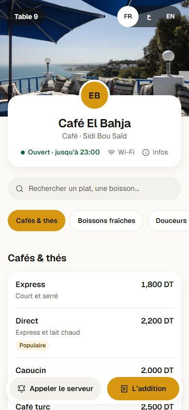
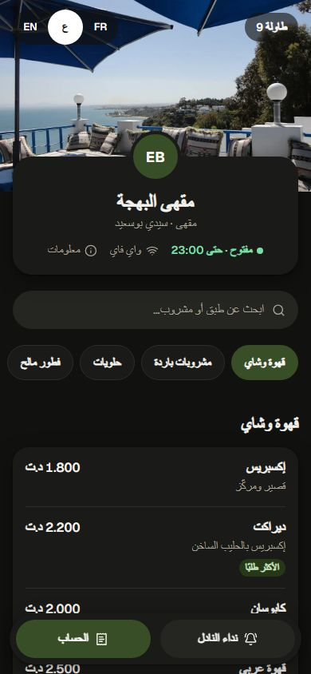
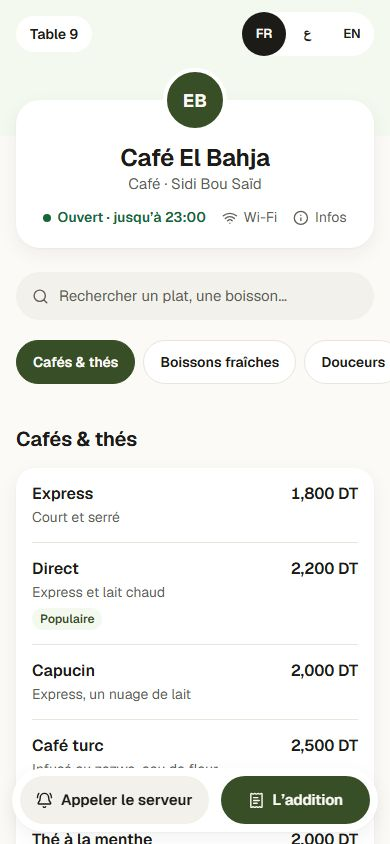
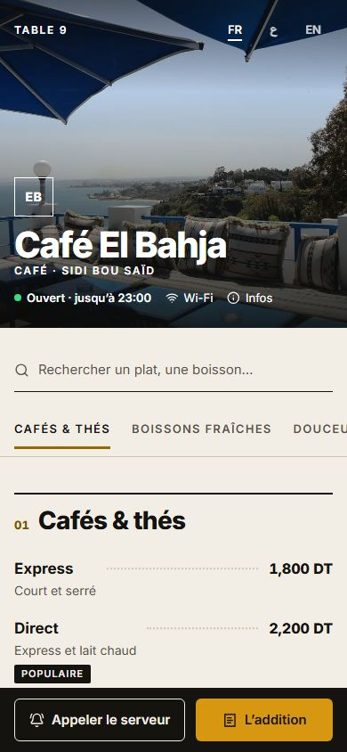
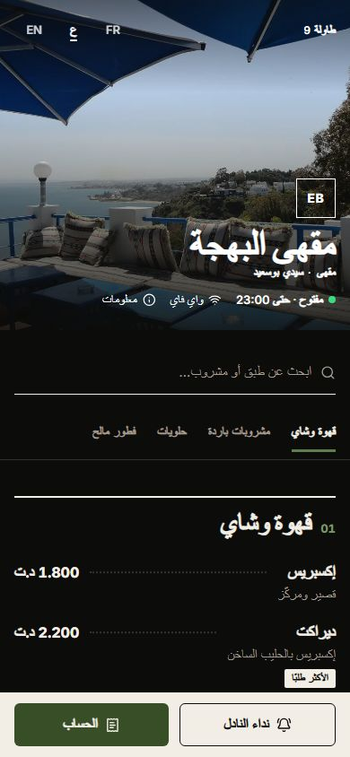
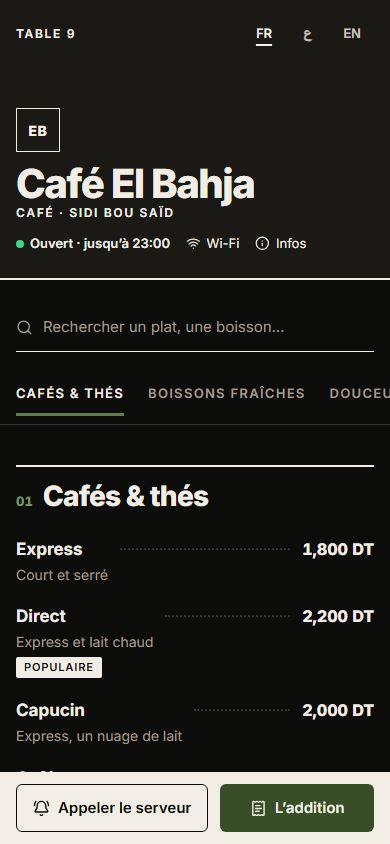
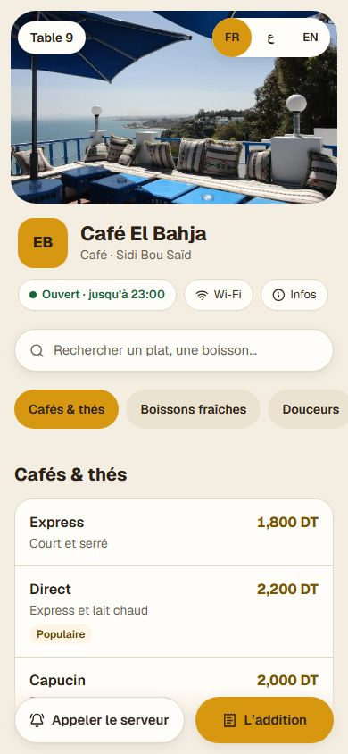
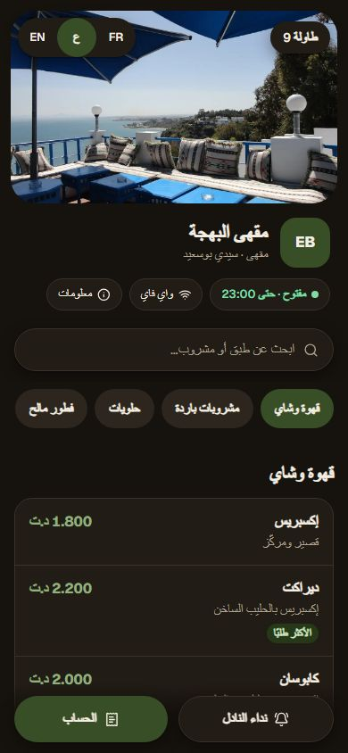
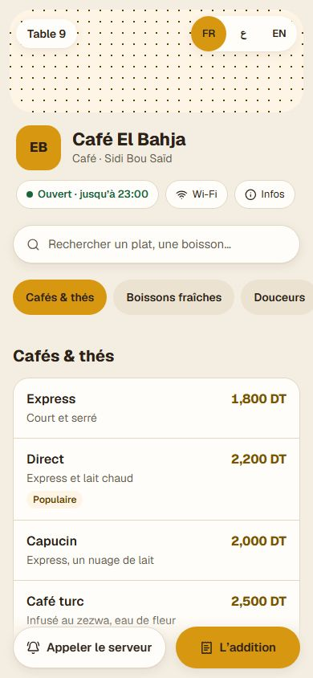

# P0-06 — Three visual directions for the customer menu

> Decision needed from the product owner (ADR-0027). The chosen direction (or a mix) becomes **ADR-0029**, and its values move into `src/styles/tokens.css` in P0-07.

**What you are looking at:** the same customer menu screen (demo café "Café El Bahja", table 9, Basic plan) rendered in three directions. Captured at **390 px** in light and dark, French and Arabic (RTL), **with and without photos**, and with two deliberately difficult tenant colours:

- **saffron** `#e8a317`, pale: the engine keeps it as the button fill with dark text;
- **olive** `#3f5a2b`, very dark: kept as the fill with light text, plus a pale tint for badges.

**Every capture passed automatically:** zero serious or critical axe violations (including WCAG AA colour contrast), no horizontal overflow, no console errors.

**File names:** `{direction}/{locale}-{theme}-{photos|nophotos}-{brand}.jpg` is the first screen after scanning; `…-full.jpg` is the whole menu. Live pages: build with `ENABLE_DEV_ROUTES=true`, then open `/dev/directions/{a|b|c}/{variant}`.

Photos: real Tunisian dishes from Wikimedia Commons (see `supabase/seed-media/ATTRIBUTION.md`). Bambalouni and strawberry juice deliberately have no photo, to show the fallback inside photo categories.

---

## A — Jasmin · calm Mediterranean editorial

| Light · FR                         | Dark · AR                       | No photos · FR                     |
| ---------------------------------- | ------------------------------- | ---------------------------------- |
|  |  |  |

- **Intent:** quiet and airy. The cover photo and the dishes carry the emotion; the interface steps back.
- **References:** Airbnb listing page, Uber Eats rows.
- **Typography:** Geist + IBM Plex Sans Arabic. Medium weights, small negative tracking on titles.
- **Components:** venue card overlapping the cover with a round logo, outline pills, soft shadows, 20 px radii, dish rows with the photo at the end.
- **Strengths:**
  - most neutral, so any tenant colour looks intentional;
  - reads naturally with or without photos;
  - closest to the calm Linear-like tone planned for the back-office, so the platform feels like one product.
- **Risks:** the most "familiar" of the three, with less of its own identity; card shadows add visual weight on long menus.

## B — Médina · bold menu-card editorial

| Light · FR                         | Dark · AR                       | No photos · FR                    |
| ---------------------------------- | ------------------------------- | --------------------------------- |
|  |  |  |

- **Intent:** a printed menu card reinvented for the phone. Big confident type, ruled sections with numbers, dotted leaders between dish and price.
- **Typography:** Inter (800 for display) + Cairo. Uppercase micro-labels with wide tracking.
- **Components:** full-bleed cover with the venue name over the photo, underline tabs, no shadows, 4 px radii, magazine grid (one featured dish then two columns).
- **Strengths:**
  - strongest personality;
  - the photo-less version is the best of the three: dotted leaders look like a real café menu, which owners recognise instantly;
  - high contrast is very glanceable, which matches the staff-app intent.
- **Risks:**
  - feels more "restaurant / bistro" than "family pâtisserie";
  - the large hero photo is the heaviest LCP element;
  - long Arabic venue names at 40 px will wrap and need a size cap.

## C — Souk · warm, tactile, friendly

| Light · FR                         | Dark · AR                       | No photos · FR                       |
| ---------------------------------- | ------------------------------- | ------------------------------------ |
|  |  |  |

- **Intent:** appetite-first and playful, like a delivery app.
- **References:** Wolt, Uber Eats grid.
- **Typography:** Geist + Cairo. Bolder weights.
- **Components:** inset rounded cover, info pills, filled category pills, two-column food grid with large square photos, dotted brand-tint tiles for dishes without photos, pill buttons.
- **Strengths:**
  - most appetising when photos exist;
  - warm sand palette suits tea rooms, pâtisseries and fast food;
  - friendliest for families and tourists.
- **Risks:**
  - the grid shows many monogram tiles when a category has few photos;
  - most visual "noise" (pills everywhere);
  - prices in brand colour depend more on the tenant colour.

---

## Recommendation (design lead)

**A as the base, borrowing B's photo-less list** (dotted leaders, numbered section titles) **for categories without photos.**

- **Fit for the market:** most Tunisian café menus are mostly photo-less (coffees, teas, juices). B's typographic list is the most premium answer to that. A's card layout is the calmest when photos exist and the most tolerant of any tenant colour.
- **One product:** A's tone carries over to the back-office (calm productivity). B's contrast and type carry over to the staff app (glanceable).

Alternatives:

- **pure B** for the strongest brand identity;
- **pure C** if the target leans towards fast food and tea rooms with good photos.

### What I need from you

Reply with **A**, **B**, **C**, or a mix ("A + B list", "C with A's header"…). Any colour or typeface preference is welcome; fonts stay within the spec (Inter or Geist, IBM Plex Sans Arabic or Cairo).
