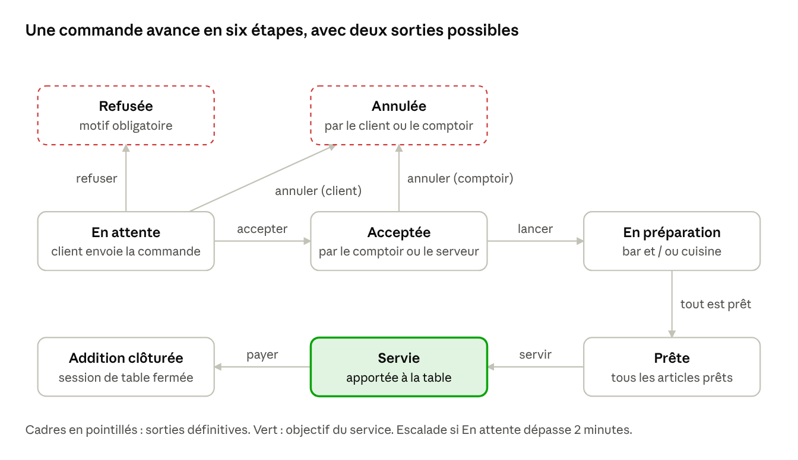

# 06 — Order lifecycle and user journeys

> Domain spec. Source: original spec §8, amended by ADR-0006, 0007, 0011, 0013. ADRs win on conflict.

## Statuses (ADR-0006)
`order_status` = `pending · accepted · preparing · ready · served · rejected · cancelled` (7 values).
Terminal: `served`, `rejected`, `cancelled`.
Bill closure is `table_sessions.status = closed`, never an order status.

## Transitions

| From → To | Actors | Condition | Effects |
|---|---|---|---|
| ∅ → pending | client session, counter, waiter, manager, owner | valid session, venue open, `ordering` enabled, products available, rate limits OK | alert counter + zone waiters per routing; timer starts; per-business-day number allocated (`#047`) |
| pending → accepted | counter, waiter (own zone or unassigned zone), manager, owner | — | customer notified; alert removed for other staff |
| pending → rejected | same | reason required (out of stock, unknown table, closed, other) | customer notified with reason |
| pending → cancelled | the ordering client; counter, manager, owner | — | alert removed for staff |
| accepted → preparing | counter, station, manager, owner | — | items sent to stations (Premium) |
| accepted → ready | counter, manager, owner | no `kitchen_display` | waiter of the zone alerted |
| preparing → ready | automatic when all items ready; counter, manager, owner | all items ready | waiter of the zone alerted |
| accepted / preparing → cancelled | counter, manager, owner | reason required | audited; customer notified |
| ready → served | waiter, counter, manager, owner | — | on the table bill |
| **accepted → served** | waiter, counter, manager, owner | **routing `waiters_only`, or no counter service started today** | on the table bill |

- Every transition is an atomic conditional update (`where status = $from`). A conflict returns `ORDER_STATE_CONFLICT`. It writes an `order_events` row (actor, reason) and bumps `version`.
- A `before update` DB trigger rejects illegal transitions (safety net).
- **Item-level (Phase 2):** staff can cancel one item before it's ready (reason, total recomputed). An order placed while the session is `bill_requested` moves the session back to `open`.
- **Escalation:** pending > 2 min (configurable) or no ack in 15 s → second sound + manager push + incident row (ADR-0007).

## Table session lifecycle (ADR-0011)
`open → bill_requested → closed`
- Opened by the first meaningful action at a table.
- `bill_requested` is set by a bill request (payment method recorded).
- `closed` happens when staff closes the bill (payment method + total snapshot) or after the inactivity timeout (default 90 min).
- Closing ends all client sessions of the table and triggers the feedback prompt.

## Service requests
`open → claimed → done`. Types: `call_waiter`, `bill` (with `payment_method`). Claiming is atomic, and the request disappears for the other staff.

## Journeys

### Customer, Basic (menu only)
1. Sits at table 9, scans the QR.
2. The menu opens in their language, with the "Table 9" badge.
3. Browses categories, photos, prices.
4. Taps "Call waiter". The staff screen shows "Table 9" with a sound.
5. The waiter takes the order verbally, as today, but the customer didn't wait for a menu.
6. "Request bill" (cash/card). After it's handled, the customer is invited to rate the visit.

### Customer, Pro (ordering)
1. Scans the QR. The first add-to-cart opens the table session.
2. Adds items with options and notes.
3. Sends the order; the tracking screen appears.
4. Counter and zone waiter receive "Table 9 — Order #047".
5. A waiter accepts; the customer sees "Accepted" live.
6. The counter prepares and marks Ready; the waiter delivers and marks Served.
7. The customer can order again; everything adds to the table bill.
8. Requests the bill with a payment method; the waiter arrives with the exact amount.
9. After payment the session is closed and the customer is invited to rate the visit.

### Manager, first day
1. Signs up, creates the venue (organization + restaurant).
2. Photographs the paper menu, AI import, corrects prices in the draft table, publishes.
3. Adds the logo; a theme colour is suggested and made accessible automatically.
4. Creates 20 tables in 2 zones.
5. Prints the QR tents.
6. Pairs the counter tablet; adds staff (Phase 2: 3 waiters with PIN, PWA installed on their phones).
7. Test from a table: call waiter (Basic) or test order (Pro). Test orders are flagged `is_test` and excluded from stats.
