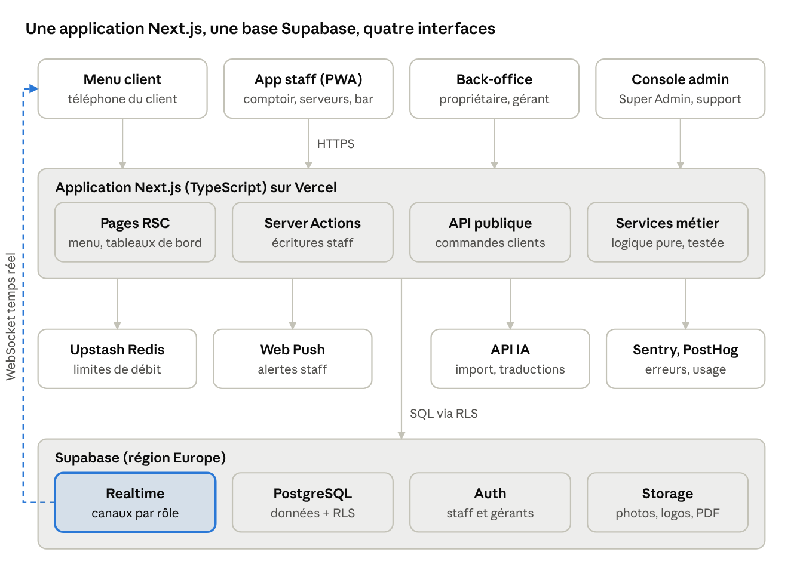

# 07 — Architecture, repository structure, API and realtime

> Domain spec. Source: original spec §9, §11, §19, amended by ADR-0002, 0003, 0008, 0012, 0016, 0017, 0020, 0022, 0024. ADRs win on conflict.

## Overview

One Next.js 16 application (TypeScript strict) on Vercel (`cdg1`) serves four surfaces: customer menu, staff PWA, back-office, Super Admin. Supabase (Paris, PG 17) provides Postgres + RLS, Auth, Realtime, Storage, Cron.



- **Modular monolith:** `src/features/*` modules with explicit public APIs. A service can be extracted later.
- **Supabase rather than a custom NestJS + Socket.io backend:** less infrastructure. A dedicated realtime server stays possible if volume requires it.
- **PWA rather than native apps:** one codebase, no store review, instant updates.
- **Realtime** goes straight from Supabase (DB triggers → private Broadcast channels) to browsers. No app server in the path (ADR-0008).
- **Writes:**
  - Route Handlers for public and staff (stable contracts, idempotent, offline-queueable);
  - Server Actions for back-office forms (ADR-0016);
  - all through pure `services/`.
- **DB access:**
  - Drizzle under `withRls(claims)` for user-scoped work;
  - one privileged module `src/server/admin/` for public writes, cron, session minting;
  - a `get_public_menu()` SQL function for menu reads (ADR-0003).
- **Tenant context** (restaurant, role, flags) is loaded once per request in RSC (`cache()`) and passed explicitly. `proxy.ts` never queries the DB (ADR-0017).

## Repository structure

```text
.
├── CLAUDE.md                     # rules for Claude Code sessions
├── README.md                     # human quick start
├── package.json                  # exact pins, packageManager pnpm@12.7.0
├── pnpm-workspace.yaml           # settings only (minimumReleaseAge 20160)
├── next.config.ts  tsconfig.json  eslint.config.mjs  prettier.config.mjs  postcss.config.mjs
├── vitest.config.ts  playwright.config.ts  drizzle.config.ts  .size-limit.json  lighthouserc.json
├── .env.example  .nvmrc  .gitignore  .gitattributes
├── .github/
│   ├── workflows/ci.yml          # typecheck, lint, unit, db tests, build, size-limit
│   ├── workflows/e2e.yml         # Playwright + axe + visual on local Supabase
│   ├── dependabot.yml
│   └── pull_request_template.md  # Definition of Done checklist
├── .husky/                       # pre-commit (lint-staged), commit-msg (commitlint)
├── docs/
│   ├── README.md                 # what to read for which task
│   ├── setup.md                  # local environment (Windows/macOS/Linux)
│   ├── cahier-des-charges.md     # ORIGINAL spec (historical; ADRs override)
│   ├── spec/                     # domain specs with every ADR applied
│   ├── adr/                      # decisions (win over everything)
│   ├── plan/                     # implementation plans
│   ├── research/                 # dated verification reports with sources
│   └── assets/                   # diagrams
├── supabase/
│   ├── config.toml               # db.major_version = 17
│   ├── migrations/               # SQL source of truth: schema, RLS, triggers, functions, cron
│   ├── seed.sql                  # demo café "Café El Bahja" (+ second tenant for isolation tests)
│   ├── seed-media/               # demo photos (licensed/generated), processed by scripts/seed-media.ts
│   └── tests/                    # pgTAP: rls_*.test.sql, functions_*.test.sql
├── scripts/                      # build-sw.ts, seed-media.ts, check-rls-coverage.ts, check-versions.mjs, screenshots.ts
├── public/                       # icons, manifests, generated sw-*.js (gitignored)
├── e2e/
│   ├── fixtures/                 # auth states, seeded ids, helpers
│   ├── client/ staff/ dashboard/ admin/   # journey specs
│   ├── a11y/                     # axe scans per screen
│   ├── visual/                   # screenshot matrix (widths × theme × locale)
│   └── __screenshots__/          # committed baselines
└── src/
    ├── proxy.ts                  # locale routing, slug rewrite, auth refresh, security headers
    ├── app/
    │   ├── [locale]/             # SINGLE root layout (html lang/dir); locale = root param (ADR-0012)
    │   │   ├── (marketing)/      # landing, pricing, legal/* — visible prefixes /ar, /en
    │   │   ├── (auth)/login|signup|reset/
    │   │   ├── t/[token]/        # customer table menu   (visible URL /t/{token})
    │   │   ├── r/[slug]/         # customer public menu  (visible URL /{slug}, proxy rewrite)
    │   │   ├── staff/            # staff PWA             (visible URL /staff/…)
    │   │   ├── dashboard/        # back-office           (visible URL /dashboard/…)
    │   │   ├── admin/            # Super Admin console
    │   │   ├── not-found.tsx     # localized 404
    │   │   └── [...rest]/        # unmatched paths → localized 404
    │   └── api/                  # route handlers (no locale)
    │       ├── public/           # sessions, service-requests, feedbacks, menu-views, orders (P2)
    │       ├── staff/            # requests, availability, acks, push-subscriptions, orders (P2)
    │       ├── devices/          # pairing
    │       ├── media/            # signed upload URL, processing
    │       ├── ai/               # menu import, translate
    │       ├── cron/[job]/       # pg_net callbacks (bearer secret)
    │       └── health/
    ├── features/                 # one folder per domain; public API via index.ts
    │   ├── auth/  tenancy/  onboarding/  menu/  tables/  sessions/  service-requests/
    │   ├── orders/ (P2)  staff/  devices/  notifications/  media/  ai/  stats/  billing/ (P3)
    │   └── <feature>/
    │       ├── components/       # React components of the feature
    │       ├── server/           # route-handler + server-action adapters (thin)
    │       ├── services/         # PURE business logic + colocated *.test.ts (no React/Next imports)
    │       ├── schemas/          # Zod schemas shared client/server
    │       ├── queries/          # withRls data access
    │       ├── hooks/            # client hooks
    │       └── index.ts          # public surface; other features import only this
    ├── server/admin/             # ONLY privileged module (secret key, raw db) — audited
    ├── components/
    │   ├── ui/                   # shadcn (Base UI) restyled on tokens
    │   ├── layout/  brand/  states/   # app shells, logos, empty/loading/error/offline states
    ├── lib/
    │   ├── db/ (client.ts, rls.ts, schema/)   supabase/ (browser.ts, server.ts)
    │   ├── auth/  flags/  money/  i18n/  realtime/  theme/  errors/  tenancy/  rate-limit/
    │   ├── env.ts                # @t3-oss/env-nextjs validation
    │   └── log.ts                # structured JSON logger
    ├── i18n/                     # next-intl routing.ts, request.ts
    ├── messages/{fr,ar,en}/      # client, staff, dashboard, admin, marketing, common .json
    ├── styles/                   # tokens.css (design tokens), globals.css
    └── sw/                       # staff-sw.ts, menu-sw.ts (built by scripts/build-sw.ts)
```

**Import boundaries** (enforced by `tooling/eslint/restrictions.mjs`, tested in `restrictions.test.mjs`):

- `app → features (index) → lib`;
- a feature imports other features only through their `index.ts`;
- `services/` imports nothing from React, Next or `lib/db`;
- only `src/lib/db/**` and `src/server/admin/**` import the raw DB client;
- only `src/server/admin/**` reads `SUPABASE_SECRET_KEY`.

## Public endpoints (customer)

| Method     | Route                                   | Purpose                                                                        | Phase |
| ---------- | --------------------------------------- | ------------------------------------------------------------------------------ | ----- |
| GET (page) | `/t/{token}`                            | Table menu, RSC, cached menu data + dynamic session hole                       | 1     |
| GET (page) | `/{slug}` → `/r/{slug}`                 | Public read-only menu (SEO)                                                    | 1     |
| POST       | `/api/public/sessions`                  | Join/open table session, set client cookie                                     | 1     |
| GET        | `/api/public/availability?r={publicId}` | Fresh availability map (focus refresh)                                         | 1     |
| POST       | `/api/public/menu-views`                | `sendBeacon` view counter (locale, table)                                      | 1     |
| POST       | `/api/public/service-requests`          | Call waiter / request bill (idempotent)                                        | 1     |
| POST       | `/api/public/feedbacks`                 | Rating + comment                                                               | 1     |
| POST       | `/api/public/orders`                    | Create order (items, options, notes, idempotency key); server recomputes total | 2     |
| GET        | `/api/public/orders/{id}`               | Order status (must belong to cookie's table session)                           | 2     |
| POST       | `/api/public/orders/{id}/cancel`        | Cancel while pending                                                           | 2     |
| GET        | `/api/public/sessions/current/bill`     | Table bill                                                                     | 2     |

## Staff and back-office

- **Route Handlers** `/api/staff/*`:
  - Phase 1: `requests/{id}/claim`, `requests/{id}/done`, `products/{id}/availability`, `acks`, `push-subscriptions`, `service/start`;
  - Phase 2: `orders/{id}/accept|reject|advance|cancel|serve`, `items/{id}/ready|cancel`, `sessions/{id}/close`, `orders` (manual), `pin-login`.
- **Server Actions:** back-office CRUD (menu, categories, options, tables, zones, staff, devices, settings, branding).
- Every handler and action: validate (Zod) → load context → `can()` → flag check → service → write `order_events` / `audit_logs` → `revalidateTag` / broadcast.
- **Error format** `{ code, message, details? }` with stable codes (ADR-0016).

## Realtime topics (ADR-0008)

| Topic                                  | Receivers                             | Events                                                |
| -------------------------------------- | ------------------------------------- | ----------------------------------------------------- |
| `r:{restaurantId}:requests`            | all active staff                      | request.created / claimed / done                      |
| `r:{restaurantId}:orders`              | counter, manager, owner               | order.created / updated                               |
| `r:{restaurantId}:zone:{zoneId}`       | zone waiters (fallback all waiters)   | order.created / ready, request.*                      |
| `r:{restaurantId}:station:{stationId}` | station                               | items.to_prepare, item.updated                        |
| `s:{tableSessionPublicId}`             | anon holders of the session public id | order.status_changed, request.handled, session.closed |
| `m:{restaurantPublicId}`               | anon                                  | product.availability_changed, menu.updated            |

All topics are private. Receive-only for clients; only DB triggers publish. Clients refetch over HTTP on (re)connect, ignore stale `version`s, and poll every 10 s when the WebSocket is down.

## Web Push

VAPID keys (env). `push_subscriptions` per device. Sent server-side after a service request or order is created and on escalation, to recipients from `resolveRecipients()` (ADR-0007). Subscriptions are deleted on 404/410.

## Multi-tenancy summary

Shared database; `restaurant_id` + RLS on every tenant table; composite FKs; `organizations` above restaurants (ADR-0004). Subdomains and custom domains for Premium later via host mapping in `proxy.ts`.
